# Ma Maison — dashboard Home Assistant

Tableau de bord web en **un seul fichier** (`maison.html`), sans dépendance ni compilation, qui pilote Home Assistant en temps réel via son API WebSocket. Il se dépose dans Home Assistant et s'ouvre dans n'importe quel navigateur : ordinateur, tablette murale ou téléphone.

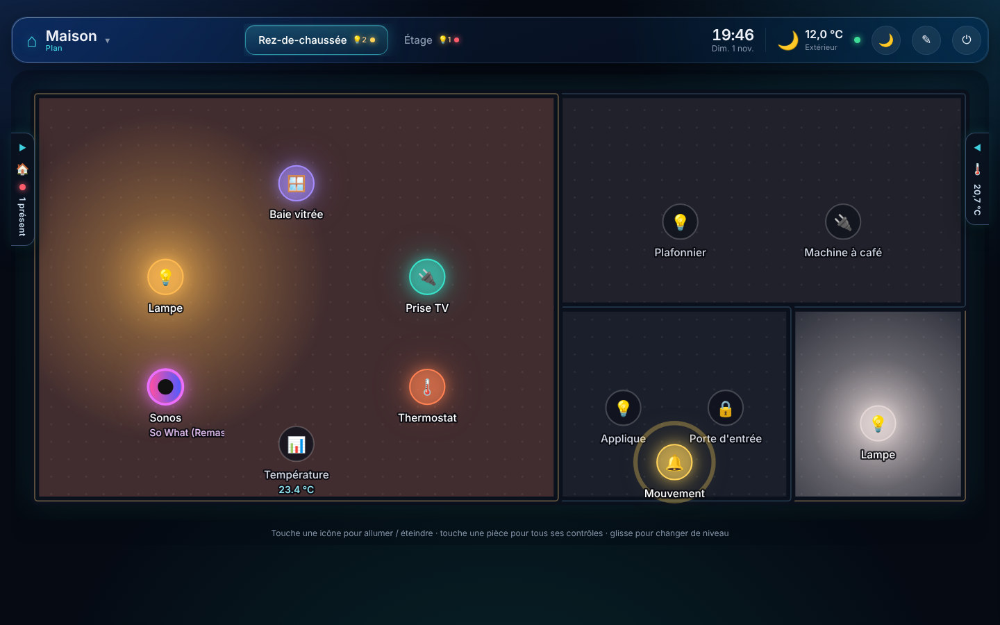

> Les captures de cette page ont été réalisées avec une maison de démonstration (données simulées).

## Sommaire

- [Plan interactif](#plan-interactif)
- [Plusieurs niveaux](#plusieurs-niveaux)
- [Panneaux latéraux](#panneaux-latéraux)
- [Contrôles d'une pièce](#contrôles-dune-pièce)
- [Mode jour / mode nuit](#mode-jour--mode-nuit)
- [Mode édition](#mode-édition)
- [Vues Pièces et Types](#vues-pièces-et-types)
- [Caméras](#caméras)
- [Connexion sécurisée](#connexion-sécurisée)
- [Sur téléphone et tablette](#sur-téléphone-et-tablette)
- [Installation](#installation)
- [Données et confidentialité](#données-et-confidentialité)

## Plan interactif

La vue **Plan** représente la maison vue de dessus. Les pièces sont générées automatiquement à partir des pièces (zones) définies dans Home Assistant, puis entièrement ajustables.

Le plan réagit en temps réel à l'état de la maison :

- **Lumières** : la pièce s'éclaire d'un halo de la **vraie couleur de l'ampoule** (RVB ou blanc chaud → froid), dont l'intensité suit la luminosité ; le halo s'arrête aux murs.
- **Température** : le sol se teinte en bleu quand il fait frais et en orangé quand il fait chaud.
- **Ouvertures** : une porte ou une fenêtre ouverte fait clignoter les murs de la pièce en rouge.
- **Présence** : une onde se propage depuis un détecteur de mouvement actif.
- **Médias** : un lecteur en cours de lecture affiche la **pochette** de ce qui joue, avec le titre et l'artiste qui défilent sous son nom.
- **Capteurs** : la valeur s'affiche sous le nom de l'icône.

Toucher une icône allume ou éteint l'appareil (ouvre ou ferme un volet, lance une caméra). Toucher une pièce ouvre le panneau de tous ses contrôles.

## Plusieurs niveaux

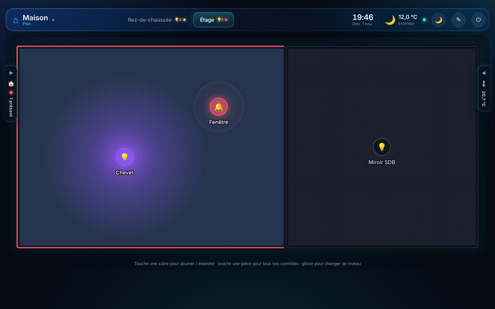

Les **étages** définis dans Home Assistant (*Paramètres → Zones, étiquettes et étages*) sont repris automatiquement. On peut aussi créer ses propres niveaux, par exemple une **dépendance**, et y répartir les pièces.

Les onglets de niveaux sont dans la barre du haut, avec des **pastilles d'activité** : nombre de lumières allumées, point jaune en cas de présence, point rouge clignotant si une ouverture est signalée. Sur tablette, on peut aussi **glisser** à gauche ou à droite sur le plan pour changer de niveau.

## Panneaux latéraux

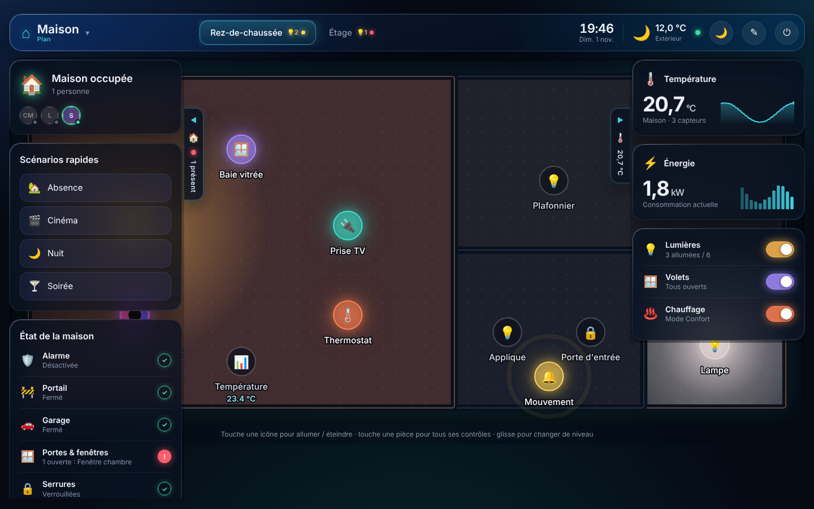

Deux panneaux flottants complètent le plan sans lui prendre de place : ils sont **repliés par défaut**, s'ouvrent **par-dessus le plan** depuis une languette sur chaque bord, et se **replient seuls après 30 secondes** sans interaction.

**À gauche**

- **Occupation** : maison occupée ou vide, avec les personnes Home Assistant et leur statut (présent, absent, zone).
- **Scénarios rapides** : toutes les scènes et scripts, lancés d'un clic.
- **État de la maison** : alarme, portail, garage, portes et fenêtres, serrures, avec une coche verte ou une alerte rouge.

**À droite**

- **Température** moyenne intérieure, avec sa courbe sur 24 h.
- **Énergie** : consommation instantanée (capteur de puissance type Linky) et histogramme sur 12 h.
- **Raccourcis** : toutes les lumières, tous les volets et le chauffage (avec son mode : Confort, Éco…).

Même repliées, les languettes affichent l'essentiel : nombre de personnes présentes, pastille d'alerte et température moyenne.

## Contrôles d'une pièce

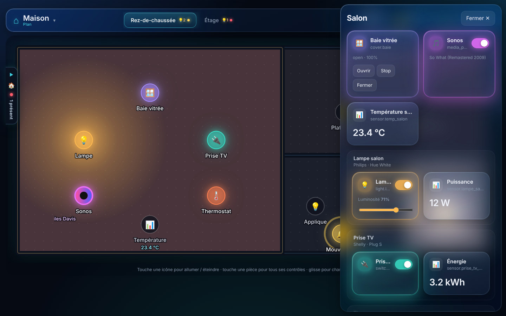

Toucher une pièce ouvre un panneau avec tous ses contrôles, **regroupés par appareil** : une ampoule connectée réunit sa lumière et sa consommation, une prise son interrupteur et son compteur. On y trouve les interrupteurs, la luminosité, les volets, la consigne du thermostat, les médias, les serrures, les scènes et les capteurs.

## Mode jour / mode nuit

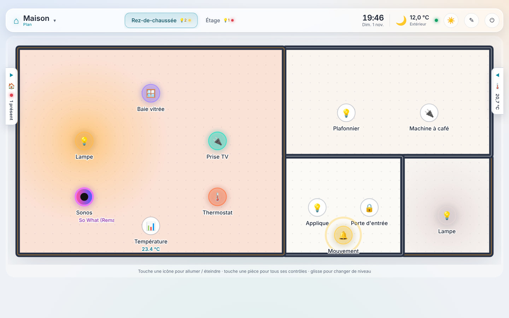

Le bouton ☀️ / 🌙 de la barre du haut bascule entre :

- un **thème nuit** bleu nuit, avec effets lumineux ;
- un **thème jour** clair, façon maquette d'architecte : sols blanc cassé, murs ardoise, halos des lumières qui teintent le sol.

Chaque mode peut avoir **sa propre photo de fond** pour chaque niveau, par exemple un rendu 3D de la maison de jour et de nuit.

## Mode édition

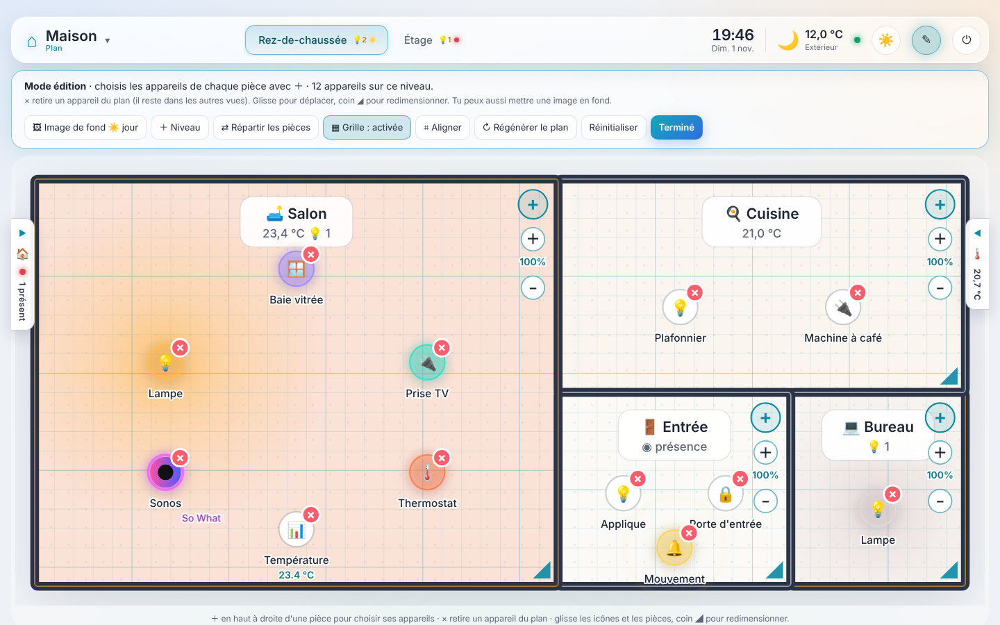

Le bouton ✎ de la barre du haut active le mode édition :

- **Pièces** : glisser pour déplacer, coin ◢ pour redimensionner. Le nom des pièces n'apparaît qu'en mode édition, pour garder un plan épuré.
- **Appareils** : chaque pièce démarre vide. Le **＋** en haut à droite d'une pièce ouvre la liste à cocher de ses entités Home Assistant, regroupées par appareil ; **×** retire un appareil du plan.
- **Taille des icônes** : boutons **＋ / −** sous le **＋** de chaque pièce (50 % à 250 %).
- **Grille d'alignement** : les icônes s'aimantent sur une grille calée sur les murs ; **Aligner** replace d'un coup toutes les icônes du niveau.
- **Niveaux** : créer, renommer, supprimer un niveau et répartir les pièces.
- **Photo de fond** : importer une image par niveau et par mode, la redimensionner avec les **poignées aux 4 coins** (proportions conservées, Maj pour un redimensionnement libre) et la déplacer avec la poignée centrale. **Superposer** affiche la photo de l'autre mode en transparence, et **Caler** reprend exactement sa position, pour aligner les photos de jour et de nuit.
- **Personnes** : retirer une personne du bandeau d'occupation.

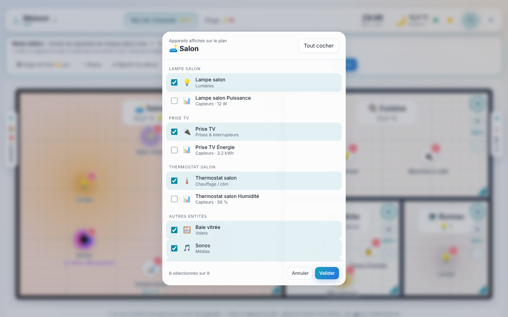

## Vues Pièces et Types

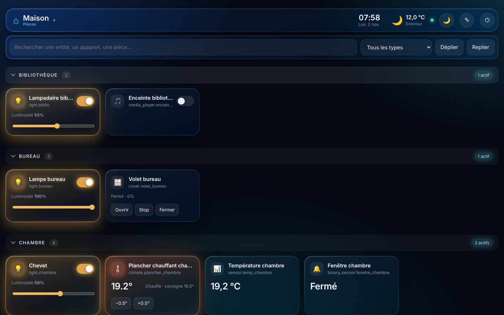

Le menu **Maison ▾** en haut à gauche donne accès à deux autres vues :

- **Pièces** : tous les contrôles, pièce par pièce, regroupés par appareil ;
- **Types** : tous les appareils par catégorie (lumières, prises, volets, chauffage, médias, capteurs…).

Les sections se replient (le choix est mémorisé), la recherche porte sur les entités, les appareils et les pièces, et un filtre limite l'affichage à un type d'appareil. En mode édition, on peut **masquer** une entité ou un appareil entier ; les entités techniques (diagnostic, configuration) sont masquées par défaut.

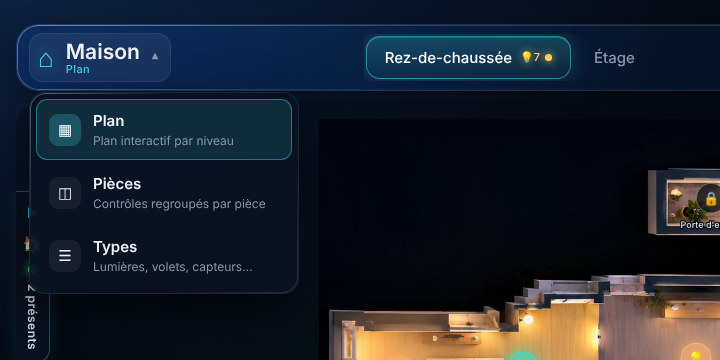

## Caméras

Les caméras affichent un aperçu rafraîchi toutes les 5 secondes. Un clic ouvre le **flux en direct** en plein écran (MJPEG), avec bascule automatique sur des images rapprochées si la caméra ne fournit pas de flux. Les images passent par le jeton temporaire que Home Assistant fournit pour chaque caméra.

## Connexion sécurisée

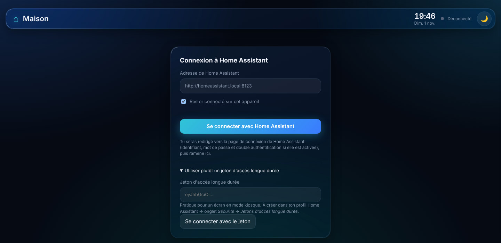

**Se connecter avec Home Assistant** utilise l'authentification OAuth intégrée à Home Assistant : on s'identifie sur la page de connexion habituelle de HA (identifiant, mot de passe, double authentification si elle est activée), puis on revient sur le dashboard.

- Le jeton d'accès dure 30 minutes et se **renouvelle automatiquement**.
- Chaque appareil apparaît dans le profil Home Assistant (*Sécurité → Jetons d'actualisation*) et peut y être **révoqué** individuellement.
- La déconnexion révoque la session côté Home Assistant.
- Pour un écran en mode kiosque, un **jeton d'accès longue durée** reste utilisable.

## Sur téléphone et tablette

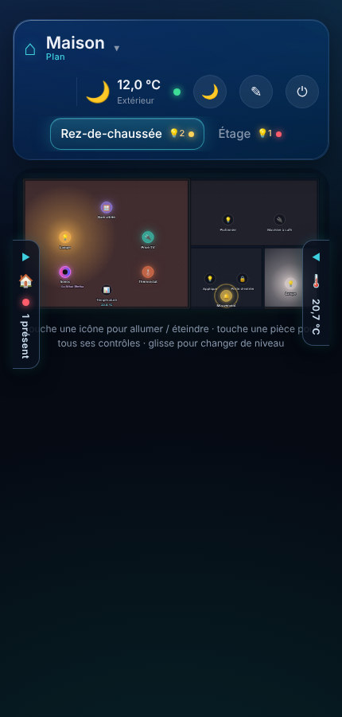

La mise en page s'adapte aux petits écrans : barre du haut sur deux lignes, plan pleine largeur, panneaux qui glissent par-dessus. Sur tablette murale, le renouvellement automatique de la session évite d'avoir à se reconnecter.

## Installation

1. Copier `maison.html` dans le dossier `/config/www/` de Home Assistant, par exemple avec l'add-on *File editor* ou *Samba*. Redémarrer HA si le dossier `www` vient d'être créé.
2. Ouvrir `http://<adresse-ha>:8123/local/maison.html`.
3. Cliquer sur **Se connecter avec Home Assistant**.
   - Alternative pour un écran en mode kiosque : « Utiliser plutôt un jeton d'accès longue durée » (profil HA → Sécurité → Jetons d'accès longue durée).
   - Si la page n'est pas servie par Home Assistant, autoriser son origine dans `configuration.yaml` (`http: cors_allowed_origins:`).
4. Passer en mode édition (✎) et ajouter les appareils de chaque pièce avec **＋**.

Après une mise à jour du fichier, recharger la page avec **Ctrl+F5** pour éviter l'ancienne version en cache.

### Prérequis

- Home Assistant avec des **pièces** définies, et idéalement des **étages** (2024.4 ou plus récent).
- Facultatif : entités `person`, `weather`, capteurs de température et de puissance, scènes et scripts pour enrichir les panneaux latéraux.

## Données et confidentialité

### Où sont stockés les réglages ?

| Donnée | Emplacement |
|---|---|
| Plan (pièces, appareils choisis et leur position, taille des icônes, grille), niveaux et répartition des pièces, entités et personnes masquées, cadrage des photos | **Home Assistant**, dans l'espace de données utilisateur des interfaces (`frontend/set_user_data`, clé `maison_dashboard`) |
| Photos de fond (une par niveau et par mode) | **Home Assistant**, dans le gestionnaire d'images (`/api/image/upload`, comme les photos de profil) |
| Dernière vue, dernier niveau, mode jour/nuit, sections repliées, session de connexion | Navigateur de l'appareil |

Conséquences :

- **Mêmes réglages sur tous les appareils** connectés avec le même compte Home Assistant : le plan configuré sur l'ordinateur apparaît sur la tablette. Les changements faits ailleurs sont récupérés à la connexion et au retour sur l'onglet.
- **Inclus dans les sauvegardes** de Home Assistant (dossier `.storage` et dossier des images).
- Les réglages sont **propres à chaque compte** : une tablette connectée avec un autre utilisateur HA a son propre plan.
- L'envoi de photos demande un **compte administrateur**. Sans ce droit, la photo reste sur l'appareil (un message l'indique dans le bandeau d'édition) ; le reste des réglages est tout de même enregistré dans HA.
- Au premier lancement de cette version, les réglages et photos déjà présents dans le navigateur sont **envoyés automatiquement** dans Home Assistant.
- Le bandeau du mode édition indique l'état : « ☁️ Enregistré dans Home Assistant », « Enregistrement… » ou un avertissement.

### Confidentialité

- Le fichier `maison.html` ne contient **aucun secret** : la connexion se fait dans le navigateur. Les fichiers de `/config/www/` étant accessibles sans authentification, rien de sensible n'y est écrit.
- Les données de la maison ne sont échangées qu'avec votre instance Home Assistant. Seule la police d'écriture (Inter) est chargée depuis Google Fonts ; sans accès Internet, la police système prend le relais.
